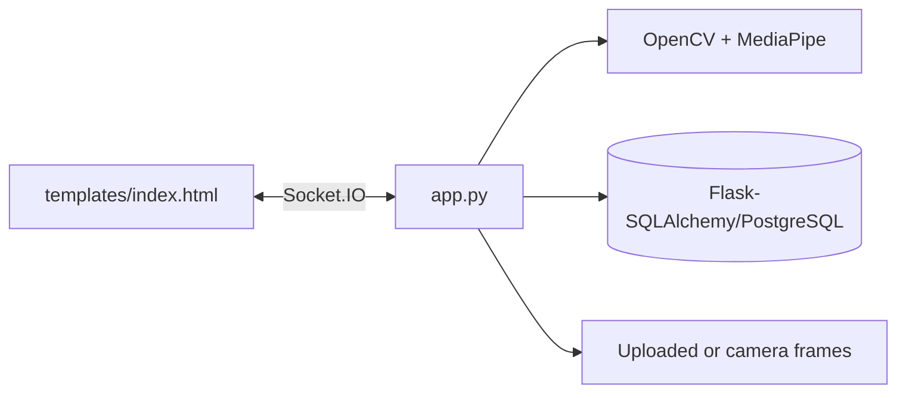

# Python Botcamp

A Flask/Socket.IO computer-vision learning application. It combines OpenCV and MediaPipe pose/vision processing with a browser UI and real-time events, with optional SQL persistence for application data.

## Architecture



## Setup

```bash
python -m venv .venv && . .venv/bin/activate
pip install -r requirements.txt
python app.py
```

The project requires Python 3.11+, native support for OpenCV/MediaPipe, and (for deployed persistence) a PostgreSQL connection. Use `gunicorn` with an appropriate Socket.IO worker configuration rather than a plain synchronous worker for real-time traffic.

## Workflow and data

The browser connects over Socket.IO, sends frames/events, and receives pose or analysis updates. `app.py` owns HTTP and socket handlers; `templates/index.html` is the primary client. Uploaded imagery and derived pose data should be treated as sensitive.

## Deployment

Set database and Flask secret configuration in the platform secret manager. Use HTTPS/WSS, a production message broker when scaling Socket.IO workers, bounded frame sizes, and explicit retention rules.

## Testing and limitations

No automated suite is declared. Test socket reconnects, malformed frames, camera permission denial, CPU/memory pressure, and browser compatibility. MediaPipe accuracy depends on lighting, camera angle, and device performance.

## Security and operations

- Keep credentials, database URLs, OAuth tokens, API keys, and signing secrets in environment variables; never commit them.
- Validate and constrain uploaded files and user input at the server boundary, and enable HTTPS in production.
- Review dependency updates and rotate any credential that has appeared in repository history.

## Testing

The repository currently has no comprehensive automated test suite unless noted above. Before production changes, add tests for authentication/authorization, validation failures, persistence errors, and the primary user workflow.

## Limitations and roadmap

This is an actively evolving project. Production hardening, observability, rate limiting, backup/retention policy, and accessibility/performance validation should be completed before handling sensitive or high-volume workloads.

## License

See the repository license file and package metadata for the authoritative terms.
