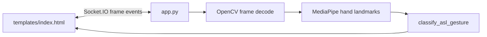

# Python Botcamp — ASL Gesture Recognition

Python Botcamp is a Flask and Socket.IO browser application that recognizes American Sign Language gestures from camera frames. OpenCV captures and decodes frames, MediaPipe supplies hand landmarks, and the server classifies supported gestures before returning results over a real-time socket connection.

## Architecture



`app.py` owns the Flask application, Socket.IO handlers, frame processing, and gesture classifier. The browser requests camera permission, emits frames through the `frame` event, and updates the recognized text area from server responses. The project also includes reference alphabet images under `static/` and `attached_assets/`.

## Current workflow

1. Open the root page and grant camera permission.
2. The browser captures frames and emits them through Socket.IO.
3. OpenCV converts each frame and MediaPipe detects hand landmarks.
4. `classify_asl_gesture` maps landmark geometry to letters and special gestures.
5. The client requires a gesture to remain stable for roughly 1.5 seconds before appending it; text can also be edited manually.

The implemented socket handlers are `connect`, `disconnect`, and `frame`. Recognition quality depends on lighting, camera angle, hand visibility, and CPU/GPU performance.

## Supported behavior

The UI is designed for ASL letters A–Z plus special actions such as space and thumbs-up/thumbs-down. The authoritative mapping is the classifier in `app.py`; the guide images are instructional references, not a separate model.

## Setup

Requirements: Python 3.11+, a working camera for live recognition, and native dependencies supported by OpenCV and MediaPipe.

```bash
python -m venv .venv
. .venv/bin/activate              # Windows: .venv\\Scripts\\activate
pip install -r requirements.txt
python app.py
```

Open the local address printed by Flask. `WINDOWS_SETUP.txt` contains platform-specific notes. For deployment, use a production WSGI/Socket.IO configuration and a process manager rather than the development server.

## Project layout

| Path | Responsibility |
| --- | --- |
| `app.py` | Flask startup, socket handlers, frame processing, classifier |
| `templates/index.html` | Camera UI, Socket.IO client, text assembly |
| `static/images/` | In-app alphabet guide |
| `attached_assets/` | Reference images used by the project |
| `requirements.txt` | Runtime dependency set |
| `pyproject.toml` / `uv.lock` | Alternative Python environment metadata |
| `WINDOWS_SETUP.txt` | Windows setup notes |

## Testing and troubleshooting

No automated test suite is declared. Manually test camera denial, reconnects, malformed frames, multiple hand positions, and browser compatibility. If the camera fails, check browser permissions and use a secure origin where required. If recognition is unstable, improve lighting, keep the hand in frame, and reduce background clutter. MediaPipe/OpenCV installation failures commonly require a supported Python version and platform wheel.

## Deployment and security

Camera frames and derived gesture data should be treated as sensitive. Use HTTPS/WSS, bound frame sizes and rates, explicit retention rules, and a production Socket.IO worker/broker design when scaling horizontally. Keep Flask secrets and database credentials out of source control; the current prototype does not document authentication or persistence as a production boundary.

## Limitations

This is a computer-vision prototype, not a certified accessibility or translation system. Landmark heuristics can misclassify signs, especially across users and environments. Validate results with representative users before relying on them for communication or assessment.

## License

See the repository license file and package metadata for the authoritative terms.
